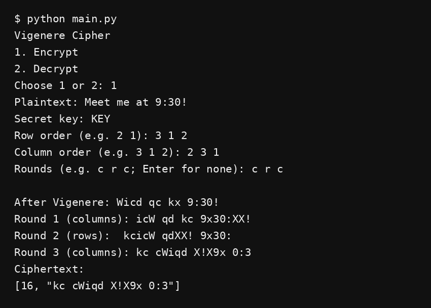
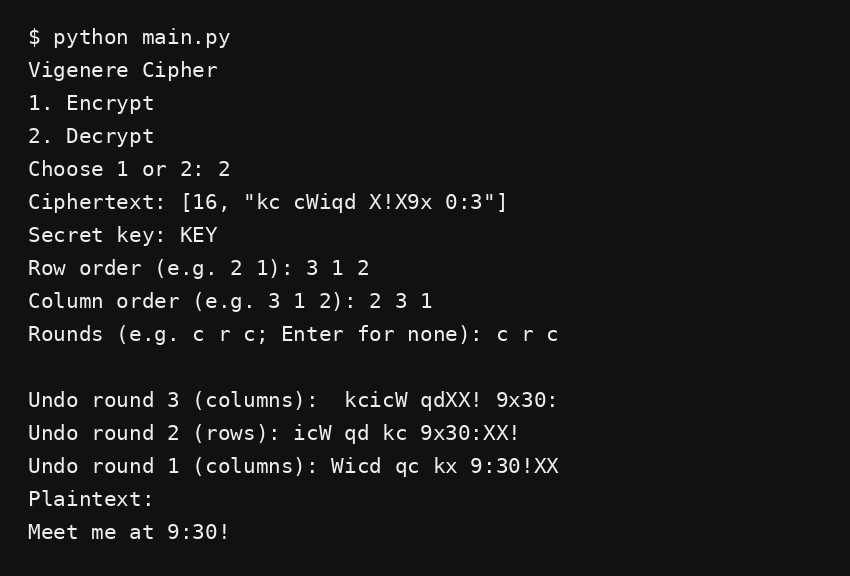

# Vigenere Cipher

A Python program for Vigenere encryption and decryption with row and column permutations.

## Running the program

Install Python 3, open a terminal in the project folder, and run:

```bash
python main.py
```

Use `python3 main.py` if your system uses the `python3` command. No extra packages are needed.

1. Choose `1` to encrypt or `2` to decrypt.
2. Enter the plaintext or copy the complete ciphertext from an earlier run.
3. Enter a keyword containing English letters.
4. Enter the row and column orders, with numbers separated by spaces.
5. Enter the permutation rounds, such as `c r` or `c r c`. Leave this blank for Vigenere only.

For decryption, enter the same keyword, row order, column order, and round sequence used for encryption. The program reverses the rounds automatically.

## How it works

Vigenere uses A = 0 through Z = 25. Encryption adds the key letter to the plaintext letter modulo 26. Decryption subtracts it. The keyword repeats over English letters only. Uppercase and lowercase are preserved. Other characters remain unchanged during substitution but move during permutations.

The number of entries in each order sets the grid size. For example, row order `2 1` and column order `3 1 2` make a 2 by 3 grid. Text is divided into blocks of six characters and each grid is filled left to right, row by row.

- A row round (`r`) rearranges whole rows. `2 1` puts the second row first.
- A column round (`c`) rearranges columns. `3 1 2` puts the third column first, then the first, then the second.
- The grid is read row by row after each round. The same orders are used for all blocks and repeated rounds.

The last block is padded with `X` if needed. The final ciphertext stores `[original length, encrypted text]`. Copy the whole line, including brackets and quotation marks. This format preserves spaces and identifies how much padding to remove, even when the original text ends in `X`.

Decryption applies the inverse permutations in reverse round order, removes the padding using the saved length, and then reverses Vigenere substitution.

## Test cases

| Plaintext | Key | Row order | Column order | Rounds | Ciphertext | Decrypted text |
| --- | --- | --- | --- | --- | --- | --- |
| `ATTACKATDAWN` | `LEMON` | `1` | `1` | blank | `[12, "LXFOPVEFRNHR"]` | `ATTACKATDAWN` |
| `ATTACKATDAWN` | `LEMON` | `2 1` | `3 1 2` | `c r` | `[12, "VOPFLXRNHREF"]` | `ATTACKATDAWN` |
| `Meet me at 9:30!` | `KEY` | `3 1 2` | `2 3 1` | `c r c` | `[16, "kc cWiqd X!X9x 0:3"]` | `Meet me at 9:30!` |

## Program output

Encryption and decryption of the third test case:




